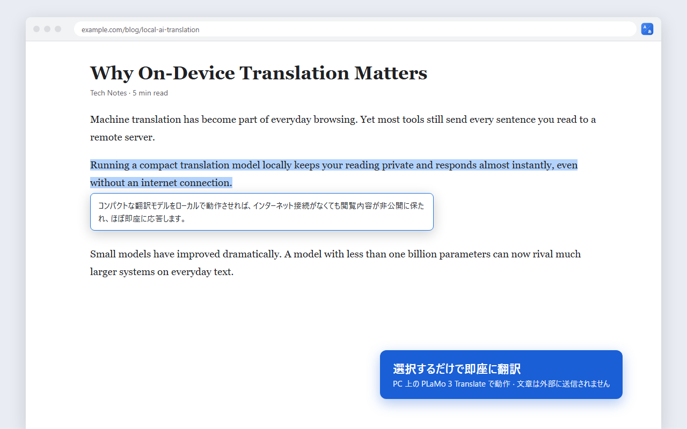

# PLaMo 選択翻訳

**Built with PLaMo**

Web ページで選択したテキストを、自分の PC で動かす **PLaMo 3 Translate**(Preferred Networks)ですぐに翻訳する Chrome 拡張機能です。

- テキストを選ぶだけで、すぐ下に翻訳が表示されます。
- 翻訳は PC の中で完結します。初期設定では文章が外部に送られず、API キーや利用料も不要です。
- 日本語を選ぶと英語に、それ以外は日本語に翻訳します(翻訳先は 53 言語から変更できます)。
- モデルは 0.8B(速い)・2B(訳文が少し自然)・使い分け(短い語句は 0.8B、文章は 2B)から選べます。



## ダウンロード

[Releases](https://github.com/DelacrowLab/plamo-select-translate/releases/latest) に次の 2 つがあります。

| ファイル | 内容 |
|---|---|
| `plamo-translate-ext-<版>.zip` | 拡張機能と翻訳サーバーのセット一式(zip で入れる人向け) |
| `plamo-translate-server-<版>.zip` | 翻訳サーバーのセットだけ(Chrome ウェブストアから拡張機能を入れた人向け) |

使い方は zip の中の「はじめにお読みください.txt」にあります。概要は次のとおりです。

1. `winget install llama.cpp` で llama.cpp を入れる
2. 拡張機能を入れる(Chrome ウェブストア、または zip をデベロッパー モードで読み込む)
3. 「自動起動を設定する.bat」でモデルを選ぶ(以後、PC にサインインすると翻訳サーバーが裏で起動)
4. 設定画面の「接続テスト」で確認する

## 翻訳サーバーの設定

`start-server.ps1` は llama.cpp の `llama-server` を次の設定で起動します。

| 設定 | 目的 |
|---|---|
| `--host 127.0.0.1` | 同じ PC からのみ接続を受け付ける |
| `--api-key plamo-select-translate` | 合言葉のない依頼を拒否する(Web ページからの単純なリクエストを防ぐ。秘密の鍵ではない) |
| `--cors-origins https://plamo-select-translate.invalid` | 実在しないオリジンだけを許可し、どの Web ページ(localhost 上のページを含む)の JavaScript からもサーバーを使えないようにする。拡張機能は Chrome のホスト権限で通信するため影響を受けない |

合言葉は公開の固定値なので、認証ではありません。同じ PC 上で動くブラウザ以外のプログラムは、合言葉を付ければ翻訳サーバーを使えます(サーバーは 127.0.0.1 のみで待ち受けるため、ほかの PC からは使えません)。

自動起動を登録すると、`start-server.ps1` を `%LOCALAPPDATA%\PLaMoSelectTranslate` にコピーし、サインイン時にはそのコピーを実行します。起動の記録は同じフォルダの `autostart.log` に残ります。
| `--no-webui --no-slots` | 使わない Web 画面と、処理中の内容を見られるエンドポイントを無効にする |
| `-ngl 0 --device none` | CPU のみで動かす(一部の GPU では出力が壊れるため) |
| `-c 8192` | 文脈長を絞ってメモリ使用量を減らす |
| `--sleep-idle-seconds 1800` | 30 分使わないとモデルをメモリから下ろす |

Mac / Linux では、llama.cpp を入れて同じ引数で `llama-server` を起動してください。

## 仕組み

モデルカードが推奨する PFML3 形式のプロンプトを、OpenAI 互換の `/v1/completions` に送っています。

```
<|plamo:tag|>dataset<|plamo:msg|>translation<|plamo:tag|>context<|plamo:msg|>{ページタイトル}<|plamo:tag|>input<|plamo:msg|>{選択テキスト}<|plamo:tag|>output<|plamo:key|>lang<|plamo:val|>ja<|plamo:msg|>
```

## 配布用 zip の作り方(開発者向け)

```
powershell -ExecutionPolicy Bypass -File build.ps1
```

`dist` フォルダに、個人配布用・ストア提出用・翻訳サーバーのセットの 3 つの zip ができます。

## プライバシー

[PRIVACY.md](PRIVACY.md) を参照してください。

## ライセンス

- この拡張機能と翻訳サーバーのセットのソースコード: [MIT License](LICENSE)
- 翻訳モデル PLaMo 3 Translate: PLaMo コミュニティライセンス契約(Preferred Networks, Inc.)。全文は [third_party](third_party) にあります。
  モデルはこのリポジトリや配布物に含まれていません。利用者が Hugging Face から各自ダウンロードします。
  個人での利用は無料です。商用利用には事前登録と、年間売上 10 億円以下であることが必要です。

この拡張機能は Preferred Networks, Inc. の公式製品ではありません。
